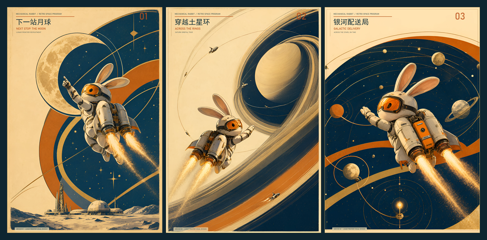
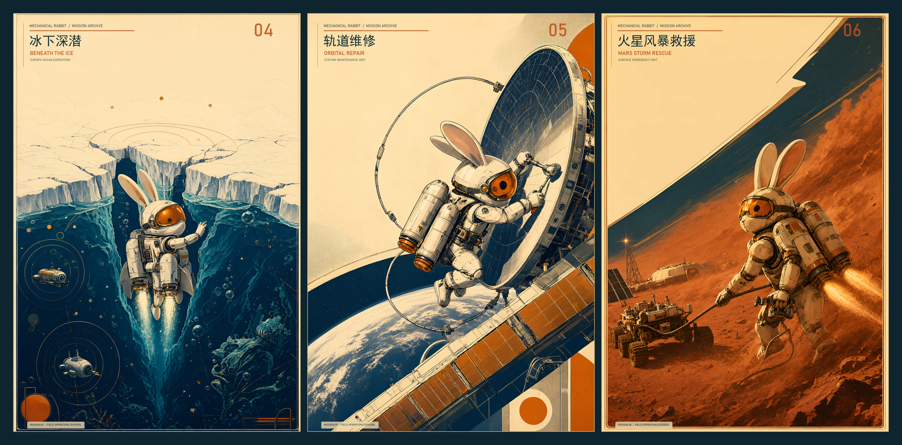

我不是没有其他生图方式。GPT 的网页端和 API 我都能用，之前也用过 GPT 和 Gemini 生图。只是在对话框里反复改图，对我来说常常像抽卡：出一张，不合适就接着聊，聊多了还遇到过文字乱码。

这次想试的是另一条路。有一定的本地硬件后，能不能用开源模型搭一套固定的生图工作流，稳定地做出个人、工作或小项目需要的图片？如果这条路能跑通，以后有合适显卡的人就可以少用一些按次付费的 API。我想趁着开源生图模型不断发展、个人电脑也越来越能跑模型，在自己的 5060 上先试一次。

我装的是千问 Image 2.1 的 Q5_K_M 版本。之前没部署过本地模型，连选哪个版本都是让 Prime Agent 配合 GPT-5.6-Sol-Medium 帮我挑的。ComfyUI 也是第一次用。看到模型介绍里提到原图精细修改和中文表现，我便拿中文海报来试。

## 先画一只兔子

模型装好后，我先让它画一只背着火箭包、透明背景的小兔子。那时还没想好要做海报，只是画出来后觉得，可以围绕这只兔子再做点什么。

我让 AI 先试几种风格，自己挑了一张喜欢的，后面基本没再碰提示词。系列的主题、画面怎么延续，主要是大模型自己往下做。我负责挑方向、看成品。

最后做了六张，按每三张一组拼成两张三联海报：兔子先去了月球、土星环和银河配送局，后来又到了冰下、轨道和火星。ComfyUI 没有现成的三联拼接工作流，Agent 就调用 Python 把图拼起来，还用 Python 添加和修改海报上的文字。

第一组：01–03，从月球到银河。[查看高清图](images/rabbit-missions-01-03.webp)

第二组：04–06，从冰下到火星。[查看高清图](images/rabbit-missions-04-06.webp)

## 有两张图没修好

六张里有两张的兔子身体不太对劲：有的手像是长在火箭包上，有的少了胳膊或腿。我当时怀疑是 Q5_K_M 量化后的损失，但没有拿满精度版本做同条件对比，不能确定原因就是它。

局部修改是我想跑通的环节之一。我试着把这些地方改好，结果改完反而更糟。之前用其他生图工具也碰到过类似的事：整张图能画出来，想只动一个细节，却很难让它听话。

中文也是我想测试的一点。过去用 GPT Image 2 做中文海报时，我见过部分文字变成乱码。这次海报上的字还有 Agent 用 Python 加工过，所以不能只看最后的成品，就说模型自己把中文写对了。

## 这条路还没跑通

这次我提想法、挑风格、看结果；Agent 写后续提示词、跑 ComfyUI，缺少拼接工作流时再用 Python 补上。两组三联海报确实做出来了，但有两张图的结构问题没修好，中文文字也经过 Python 处理。它还不是一套能稳定交付合格图片的固定工作流。

我想继续试这条路，是因为它不只关乎我自己画几张图。如果以后能把生成和局部修改做稳定，有工作需求、或者刚开始做项目的人，也许能用自己电脑上的开源模型做出够用的图片，少付一些 API 调用费。当然，本地生图只是没有那笔按次调用费；显卡、电力和折腾工作流的时间都不是零成本。这一次，我还不能说哪种方式更划算。
